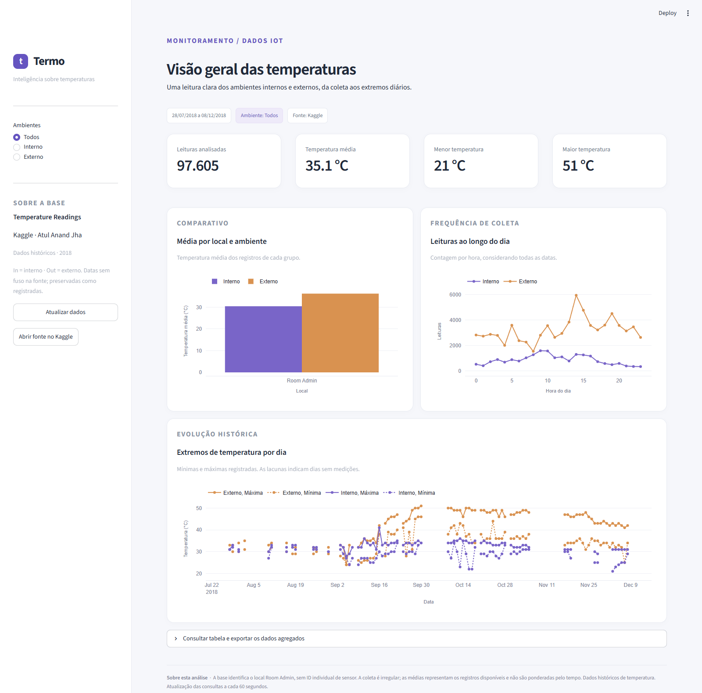

# Termo · Pipeline de dados IoT

Trabalho de **Disruptive Architectures: IoT e Big Data**. Pipeline em lote com Python, pandas e SQLAlchemy, armazenamento em PostgreSQL no Docker e dashboard Streamlit/Plotly. Usa a base real [Temperature Readings: IoT Devices, de Atul Anand Jha](https://www.kaggle.com/datasets/atulanandjha/temperature-readings-iot-devices).

**Relatorio:** [documentacao_termo.pdf](docs/documentacao_termo.pdf).



## Resultado verificado

- CSV original: **97.606 linhas**. Um ID duplicado com conteudo identico; **97.605 leituras unicas** no banco, zero rejeicoes por formato.
- Periodo: **28/07/2018 07:06 a 08/12/2018 09:30**, com registros em 86 dias.
- Interno: **20.345 leituras**, media **30,45 °C**, minimo 21 °C e maximo 41 °C.
- Externo: **77.260 leituras**, media **36,27 °C**, minimo 24 °C e maximo 51 °C.
- As contagens, medias e extremos das tres views foram conferidos contra calculos independentes em pandas. Evidencias em `docs/resultados/`.

As medias se referem aos registros, com frequencia irregular, sem ponderacao pelo tempo. Ha apenas um rotulo de local (`Room Admin`), sem identificador individual de sensor. O projeto adota °C para a apresentacao da temperatura, sem conversao; o CSV nao traz unidade nem fuso horario. A diferenca de medias entre ambientes e descritiva, sem demonstrar causalidade. O processamento utiliza uma base historica, sem captura ao vivo.

## Execucao completa com Docker (recomendada)

Requisitos: Docker Desktop iniciado, Docker Compose v2 e internet na primeira construcao. Nao e necessario instalar Python no computador para esta opcao.

1. Baixe a base no link do Kaggle e extraia **IOT-temp.csv** na pasta `data/`.
2. No PowerShell, dentro desta pasta:

```powershell
Copy-Item .env.example .env
notepad .env
```

Defina uma senha local em `POSTGRES_PASSWORD` e a mesma senha em `DATABASE_URL`. Se a senha tiver caracteres especiais na URL, codifique-os; a configuracao dos containers usa campos separados e aceita caracteres especiais. Mantenha `.env` privado. No computador em que o trabalho foi montado, o arquivo ja esta configurado com senha aleatoria.

3. Execute:

```powershell
docker compose up -d --build
docker compose ps -a
docker compose logs ingest
```

O Compose aguarda o banco ficar saudavel, executa a importacao e inicia o dashboard somente se a importacao terminar com sucesso. O importador sair com codigo 0 e esperado. Aguarde essa etapa e abra **http://localhost:8501**. Tambem e possivel usar `iniciar.bat`.

O PostgreSQL fica acessivel apenas localmente em `127.0.0.1:55432`. O dashboard fica na porta 8501. O volume `postgres_data` preserva os dados quando os containers sao parados. Para encerrar preservando o banco:

```powershell
docker compose down
```

Nao use `down -v` se quiser preservar os dados. Se mudar usuario/senha depois que o volume foi criado, atualize as credenciais no PostgreSQL; as variaveis `POSTGRES_*` so configuram um banco novo.

## Alternativa: Python local e PostgreSQL no Docker

Requisitos: Python 3.12, Docker Desktop iniciado e `.env` configurado.

```powershell
python -m venv .venv
.\.venv\Scripts\python.exe -m pip install -r requirements.txt
docker compose up -d db --wait
.\.venv\Scripts\python.exe -m src.pipeline --csv data/IOT-temp.csv
.\.venv\Scripts\python.exe -m streamlit run dashboard.py
```

Se o dashboard em container ja estiver usando a porta 8501, pare apenas esse servico (`docker compose stop dashboard`) ou use `--server.port 8502` no comando Streamlit local.

## Arquitetura e processamento

`CSV Kaggle -> validacao pandas -> staging temporario -> PostgreSQL -> 3 views SQL -> Streamlit / Plotly`

`src/pipeline.py` verifica o esquema do CSV, converte datas com formato explicito `%d-%m-%Y %H:%M` e temperaturas para numeros, valida campos obrigatorios e ambientes `In`/`Out`, rejeita valores nao finitos e remove apenas IDs repetidos com conteudo identico. Leituras iguais com IDs distintos sao preservadas. Datas sao armazenadas sem fuso, como na origem.

O importador executa criacao do esquema, carga temporaria, verificacao de conflitos, insercao e auditoria em uma transacao. A chave primaria `reading_id` e `ON CONFLICT DO NOTHING` tornam a reexecucao idempotente. Se um ID existente tiver conteudo diferente, toda a carga e cancelada. Um bloqueio transacional serializa importadores deste projeto. O CSV inteiro e lido em memoria e inserido em lotes de mil; bases maiores exigiriam leitura em chunks, COPY e monitoramento.

O historico em `import_runs` armazena nome do arquivo, SHA-256, quantidade de linhas de entrada, rejeicoes, duplicatas, insercoes e registros ja existentes. `docs/resultados/ultima_importacao.json` descreve a ultima execucao; `primeira_importacao.json` preserva a carga inicial. Linhas invalidas sao exportadas com numero da linha e motivo.

## Views SQL

Definicoes completas em `sql/02_views.sql`:

| View | Agrupamento e medidas | Uso no dashboard |
|---|---|---|
| `avg_temp_por_dispositivo` | Local (`device_id`) e ambiente; contagem, media, minima e maxima | Barras comparativas; separa In e Out |
| `leituras_por_hora` | Hora do dia (0 a 23) e ambiente; contagem | Distribuicao da coleta; soma todas as datas, sem representar uma serie cronologica |
| `temp_max_min_por_dia` | Data e ambiente; contagem, media, minima e maxima | Evolucao dos extremos diarios; lacunas explicitas nos dias sem registros |

Views convencionais consultam as tabelas a cada execucao; nao sao copias materializadas. O dashboard usa consultas fixas e cache de 60 segundos, com botao para atualizar. O filtro Interno/Externo se aplica aos indicadores, aos tres graficos e a exportacao diaria. O periodo exibido corresponde a base completa.

## Insights e aplicacoes

A media externa supera a interna em aproximadamente **5,81 °C**; isso pode orientar investigacoes sobre exposicao solar e ventilacao, sem provar suas causas. O maximo externo de **51 °C** sugere verificar instalacao/calibracao do sensor antes de qualquer decisao operacional. A maior concentracao global de registros ocorre as **14h**; representa atividade de coleta, nao necessariamente o periodo mais quente. A predominancia de leituras externas (aproximadamente 79,2%) faz a media geral de 35,05 °C se aproximar mais desse ambiente.

Em uso real, o pipeline poderia apoiar manutencao, conservacao de materiais e planejamento de climatizacao. Alertas exigiriam limites definidos para o contexto, sensores calibrados e monitoramento continuo. Evolucoes possiveis: MQTT, ingestao incremental, particoes por data, usuario de banco somente leitura para o dashboard e modelos de anomalias validados. O volume atual e uma demonstracao academica, sem alegacao de processamento distribuido ou Big Data em producao.

## Testes e reproducao da analise

```powershell
.\.venv\Scripts\python.exe -m pip install -r requirements-dev.txt
$env:RUN_POSTGRES_TESTS='1'
.\.venv\Scripts\python.exe -m pytest -q
.\.venv\Scripts\python.exe -m docs.exportar_resultados
```

Foram aprovados **11 testes**, incluindo validacoes, datas, deduplicacao, idempotencia, valores das views e rollback. Os testes de integracao criam e removem um schema temporario, preservando as leituras reais. Sem `RUN_POSTGRES_TESTS=1`, os dois testes que dependem de banco sao pulados.

Tambem foram verificados no navegador os tres graficos, os totais por ambiente e o download do CSV. A captura opcional `docs/capturar_dashboard.cjs` requer Node.js, Playwright e Microsoft Edge. As capturas em `docs/imagens/` mostram a aplicacao real com PostgreSQL.

## Estrutura

```text
dashboard.py             Interface Streamlit
src/pipeline.py          Validacao, ingestao e auditoria
src/database.py          Conexao e inicializacao do esquema
src/analytics.py         Consultas as views
sql/01_schema.sql        Tabelas, restricoes e indice
sql/02_views.sql         Tres views
data/README.md           Fonte e instrucoes do CSV
docs/imagens/            Capturas reais do dashboard
docs/resultados/         Evidencias de importacao e reconciliacao
docs/documentacao_termo.pdf  Relatorio academico
docs/roteiro_pitch.md    Roteiro de ate quatro minutos
tests/                  Validacao e integracao PostgreSQL
compose.yaml            Banco, importador e dashboard
Dockerfile              Imagem Python
.env.example            Exemplo de configuracao sem segredo real
```

## Git e publicacao

Para publicar manualmente, entre na sua conta do GitHub, crie um repositorio publico e use **Add file > Upload files**. Envie o conteudo desta pasta, incluindo os arquivos ocultos de configuracao. Nao envie `.env`, `.venv`, `.git` nem o CSV original. O link do Kaggle esta incluido neste README.

Como alternativa ao envio pelo navegador, estes sao os comandos Git para publicar em um repositorio criado na sua conta:

```powershell
git init
git add .
git commit -m "Implementa pipeline IoT com PostgreSQL e Streamlit"
git remote add origin URL_DO_SEU_REPOSITORIO
git push -u origin HEAD
git pull --ff-only
git push
```

Se o repositorio local ja estiver inicializado, comece pela autenticacao/publicacao. `.env`, `.venv` e a base original ficam fora do Git. O link para download do Kaggle atende a alternativa de disponibilizacao da base prevista no enunciado.

## Entrega

Envie o PDF em `docs/documentacao_termo.pdf`, o link do repositorio publico e o link do video de ate quatro minutos. Siga `docs/roteiro_pitch.md` para gravar. A publicacao do video e a verificacao do acesso ao repositorio devem ser feitas antes do envio na plataforma.

## Referencias

- [Kaggle: Temperature Readings: IoT Devices](https://www.kaggle.com/datasets/atulanandjha/temperature-readings-iot-devices)
- [Docker: ordem de inicializacao no Compose](https://docs.docker.com/compose/how-tos/startup-order/)
- [PostgreSQL: CREATE VIEW](https://www.postgresql.org/docs/17/sql-createview.html)
- [SQLAlchemy: transacoes](https://docs.sqlalchemy.org/en/21/tutorial/dbapi_transactions.html)
- [Streamlit: graficos Plotly](https://docs.streamlit.io/develop/api-reference/charts/st.plotly_chart)
- [Streamlit: cache](https://docs.streamlit.io/develop/concepts/architecture/caching)
